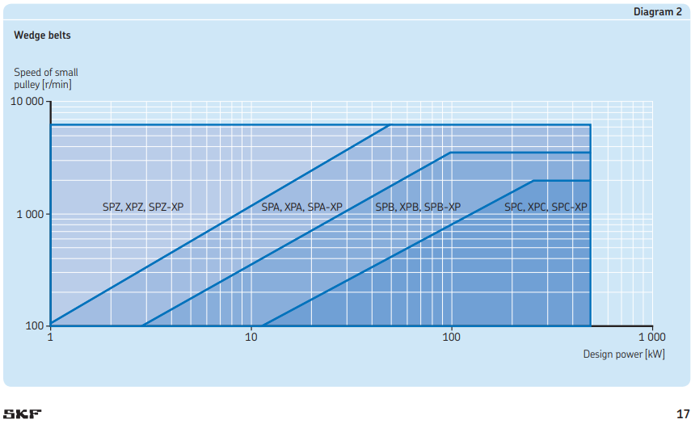

# Entrega Final — Mecánica II (Mecatrónica 2026)
## Resolución Completa de Trabajo Práctico N° 6 (Rodamientos SKF) y Trabajo Práctico N° 7 (Correas SKF)

---

## Parte 1: Trabajo Práctico N° 6 — Selección y Cálculo de Rodamientos

### Datos del Enunciado
* **Velocidad de rotación del eje:** $n = 2400\text{ rpm}$ (constante)
* **Diámetros de asiento:**
  * **Apoyo 1 (Rodamiento A):** $d_1 = 40\text{ mm}$ (ubicado a $x = 10\text{ cm}$ de la polea)
  * **Apoyo 2 (Rodamiento B):** $d_2 = 30\text{ mm}$ (ubicado a $x = 55\text{ cm}$ de la polea, $25\text{ cm}$ a la derecha del engranaje)
* **Reacciones en los apoyos según los diagramas de los planos ortogonales $x\text{-}y$ y $x\text{-}z$:**
  * **Plano $x\text{-}y$:** $R_{Ay} = 390\text{ kgf}$, $R_{By} = 39\text{ kgf}$
  * **Plano $x\text{-}z$:** $R_{Az} = 521\text{ kgf}$, $R_{Bz} = 55\text{ kgf}$

### 1. Fuerza Radial Resultante ($P = F_r$) en cada apoyo
Al no existir fuerzas axiales ($F_a = 0$), la carga dinámica equivalente sobre cada rodamiento rígido de bolas es puramente radial ($P = F_r$):

* **Apoyo 1 ($d_1 = 40\text{ mm}$):**
  $$F_{r1} = \sqrt{R_{Ay}^2 + R_{Az}^2} = \sqrt{390^2 + 521^2} = \sqrt{423\,541} = 650,80\text{ kgf}$$
  $$P_1 = 650,80\text{ kgf} \times \frac{9,81\text{ N/kgf}}{1000\text{ N/kN}} = \mathbf{6,384\text{ kN}}$$

* **Apoyo 2 ($d_2 = 30\text{ mm}$):**
  $$F_{r2} = \sqrt{R_{By}^2 + R_{Bz}^2} = \sqrt{39^2 + 55^2} = \sqrt{4546} = 67,42\text{ kgf}$$
  $$P_2 = 67,42\text{ kgf} \times \frac{9,81\text{ N/kgf}}{1000\text{ N/kN}} = \mathbf{0,6614\text{ kN}}$$

### 2 y 3. Selección del Catálogo General SKF y Cálculo de Vida Útil Nominal ($L_{10}$ y $L_{10h}$)
Fórmulas de duración nominal para rodamientos de bolas ($p = 3$):
$$L_{10} = \left(\frac{C}{P}\right)^3 \text{ [millones de revoluciones]} \qquad ; \qquad L_{10h} = \frac{10^6}{60 \cdot n} \cdot L_{10} = 6,9444 \cdot L_{10} \text{ [horas]}$$

#### Tabla SKF 1.1 — Rodamientos Rígidos de Bolas para Apoyo 1 ($d_1 = 40\text{ mm}$, Catálogo pág. 328 / PDF pág. 332)
| Designación SKF | $d\text{ [mm]}$ | $D\text{ [mm]}$ | $B\text{ [mm]}$ | $C\text{ [kN]}$ | $C_0\text{ [kN]}$ | $L_{10}\text{ [10}^6\text{ rev]}$ | $L_{10h}\text{ [horas]}$ |
| :--- | :---: | :---: | :---: | :---: | :---: | :---: | :---: |
| `61808` | 40 | 52 | 7 | 4,49 | 3,75 | 0,35 | 2,4 h |
| `61908` | 40 | 62 | 12 | 13,8 | 10,0 | 10,10 | 70,1 h |
| `* 16008` | 40 | 68 | 9 | 13,8 | 10,2 | 10,10 | 70,1 h |
| `* 6008` | 40 | 68 | 15 | 17,8 | 11,0 | 21,68 | 150,5 h |
| `* 6208` | 40 | 80 | 18 | 32,5 | 19,0 | 131,93 | 916,2 h |
| `6208 ETN9` | 40 | 80 | 18 | 35,8 | 20,8 | 176,35 | 1224,7 h |
| **`* 6308` (Seleccionado)** | **40** | **90** | **23** | **42,3** | **24,0** | **290,90** | **2020,1 h** |
| **`6408` (Serie pesada)** | **40** | **110** | **27** | **63,7** | **36,5** | **993,44** | **6898,9 h** |

#### Tabla SKF 1.1 — Rodamientos Rígidos de Bolas para Apoyo 2 ($d_2 = 30\text{ mm}$, Catálogo pág. 326 / PDF pág. 330)
| Designación SKF | $d\text{ [mm]}$ | $D\text{ [mm]}$ | $B\text{ [mm]}$ | $C\text{ [kN]}$ | $C_0\text{ [kN]}$ | $L_{10}\text{ [10}^6\text{ rev]}$ | $L_{10h}\text{ [horas]}$ |
| :--- | :---: | :---: | :---: | :---: | :---: | :---: | :---: |
| `61806` | 30 | 42 | 7 | 4,49 | 2,90 | 312,9 | 2173,0 h |
| **`61906` (Ej. cátedra)** | **30** | **47** | **9** | **7,28** | **4,55** | **1333,5** | **9260,7 h** |
| `* 16006` | 30 | 55 | 9 | 11,9 | 7,35 | 5824,3 | 40\,446,5 h |
| `* 6006` | 30 | 55 | 13 | 13,8 | 8,30 | 9083,6 | 63\,080,6 h |
| **`* 6206` (Seleccionado)** | **30** | **62** | **16** | **20,3** | **11,2** | **28\,914,4** | **200\,794,4 h** |
| `6206 ETN9` | 30 | 62 | 16 | 23,4 | 12,9 | 44\,284,4 | 307\,530,5 h |
| `* 6306` | 30 | 72 | 19 | 29,6 | 16,0 | 89\,637,5 | 622\,482,6 h |
| `6306 ETN9` | 30 | 72 | 19 | 32,5 | 17,3 | 118\,649,1 | 823\,952,1 h |
| `6406` | 30 | 90 | 23 | 43,6 | 23,6 | 286\,459,0 | 1\,989\,298,6 h |

---

## Parte 2: Trabajo Práctico N° 7 — Cálculo y Selección de Correas SKF

### Datos del Enunciado Oficial
* **Motor conductor:** Motor eléctrico trifásico de inducción, $P_r = 75\text{ HP} = 55,93\text{ kW}$, $n_1 = 1450\text{ rpm}$, **Arranque Directo** (*Heavy starts*), polea mayor $D = 320\text{ mm}$.
* **Máquina conducida:** Bomba centrífuga (*centrifugal pump*), régimen ligero (**Clase 1**), $n_2 = 1856\text{ rpm}$, polea menor $d = 250\text{ mm}$.
* **Régimen de trabajo continuo:** $20\text{ horas diarias}$ (columna **$> 16\text{ h/día}$**).
* **Distancia entre centros preliminar:** $CC_p = 650\text{ mm}$.
* **Relación de transmisión:** $I_r = \frac{n_2}{n_1} = \frac{1856}{1450} = \frac{320}{250} = 1,28$ (Multiplicador de velocidad).

---

### Memoria de Cálculo Paso a Paso (Criterio Cátedra Oficial: $C_2 = 1,30$)

#### Paso 1: Factor de Servicio ($C_2$) y Potencia de Diseño ($P_d$)
* **De la Tabla 3 (Catálogo SKF pág. 16):**
  * Tipo de máquina conducida: Bomba centrífuga $\implies$ **Class 1 (Light duty)**.
  * Horas de trabajo por día: $20\text{ h/día} \implies$ **Over 16** ($> 16\text{ horas}$).
  * Características de arranque: Al ser **arranque directo** sobre la red, corresponde a **Heavy starts** (arranque pesado).
  * Intersección exacta en Tabla 3:
    $$\mathbf{C_2 = 1,30}$$
* **Conversión de Potencia del Motor a kW:**
  $$P_r = 75\text{ HP} \times 0,7457\text{ kW/HP} = \mathbf{55,93\text{ kW}}$$
* **Potencia de Diseño ($P_d$):**
  $$P_d = P_r \times C_2 = 55,9275\text{ kW} \times 1,30 = \mathbf{72,71\text{ kW}}$$
  *(Nota comparativa: Si se aplicase el factor multiplicador adicional $+0,05$ de Tabla 1 por aumento de velocidad, $C_{2,\text{SKF}} = 1,30 \times 1,05 = 1,365 \implies P_d = 76,34\text{ kW}$. Ambos criterios conducen a la misma cantidad de 4 correas).*

#### Paso 2: Selección del Perfil de Correa (Diagrama 2 pág. 17 y Tabla 5a pág. 36)
* **Ingreso al Diagrama 2 de SKF (*Wedge belts*):**
  * Eje de abscisas: Potencia de diseño $\mathbf{P_d = 72,71\text{ kW}}$.
  * Eje de ordenadas: Velocidad de giro de la polea más rápida $\mathbf{n_2 = 1856\text{ rpm}}$.
  
  

* **Interpretación del Diagrama 2 y Selección de la Serie SPB-XP:**
  * En la escala logarítmica del Diagrama 2, para $P_d = 72,71\text{ kW}$ y $n = 1856\text{ rpm}$, el punto de funcionamiento cae con total precisión dentro de la zona delimitada para:
    $$\mathbf{\text{SPB, XPB, SPB-XP}}$$
  * **Familia de Correas Trapeciales Estrechas SKF:**
    1. **SPB:** Correa trapecial estrecha estándar envuelta de alto rendimiento.
    2. **XPB:** Correa trapecial estrecha dentada de flancos abiertos (*raw edge, cogged*).
    3. **SPB-XP (Extra Power):** Gama superior de potencia reforzada (*eXtra Power*), dotada de cordones tensores de poliéster de bajo estiramiento de última generación y recubrimiento textil de alta adherencia y resistencia térmica. Proporciona una capacidad de transmisión y vida útil significativamente superiores, ideal para soportar el régimen continuo (20 h/día) y el impacto del **arranque directo** del motor.
* **Geometría normalizada del perfil SPB / SPB-XP:**
  * Ancho superior: $b_o = 16,3\text{ mm}$
  * Ancho primitivo: $b_d = 14,0\text{ mm}$
  * Altura de la sección: $h = 13,0\text{ mm}$
  * Diámetro primitivo mínimo recomendado (Tabla 5a): $d_{\min} = 140\text{ mm}$
* **Verificación de diámetro mínimo:**
  $$d = 250\text{ mm} \ge d_{\min} = 140\text{ mm} \quad \text{(Cumple holgadamente } \checkmark\text{)}$$

#### Paso 3: Longitud Primitiva Preliminar ($L_d$), Longitud Comercial y Distancia entre Centros Definitiva ($CC$)
* **Verificación del Rango de Distancia entre Centros Preliminar ($CC_p = 650\text{ mm}$):**
  $$0,7 \cdot (D + d) \le CC_p \le 2,0 \cdot (D + d)$$
  $$0,7 \cdot (320 + 250) = 399\text{ mm} \le 650\text{ mm} \le 2,0 \cdot (320 + 250) = 1140\text{ mm} \quad \text{(Cumple } \checkmark\text{)}$$
* **Longitud Primitiva Teórica Preliminar ($L_d$):**
  $$L_{d,\text{prelim}} = 2 \cdot CC_p + 1,57 \cdot (D + d) + \frac{(D - d)^2}{4 \cdot CC_p}$$
  $$L_{d,\text{prelim}} = 2(650) + 1,57(320 + 250) + \frac{(320 - 250)^2}{4(650)} = 1300 + 894,90 + 1,88 = \mathbf{2196,78\text{ mm}}$$
* **Selección de la Longitud Comercial Normalizada SKF (Catálogo pág. 83 y Tabla 8 pág. 40):**
  * La longitud comercial más cercana a $2196,78\text{ mm}$ es **$2180\text{ mm}$**:
    $$\text{Designación comercial: } \mathbf{\text{PHG SPB2180}} \quad (L_d = 2180\text{ mm})$$
    * Factor de corrección de longitud (Tabla 8): $\mathbf{C_1 = 0,92}$.
  * *(Alternativa inmediata superior: `PHG SPB2240` con $L_d = 2240\text{ mm}$, $C_1 = 0,93$ y $CC = 671,6\text{ mm}$)*.
* **Distancia entre Centros Definitiva ($CC$) para SPB2180:**
  Resolviendo la ecuación cuadrática de SKF:
  $$A = \frac{L_d}{4} - \frac{\pi}{8}(D + d) = \frac{2180}{4} - \frac{\pi}{8}(570) = 545 - 223,84 = 321,16\text{ mm}$$
  $$B = \frac{(D - d)^2}{8} = \frac{(320 - 250)^2}{8} = \frac{4900}{8} = 612,5\text{ mm}^2$$
  $$CC = A + \sqrt{A^2 - B} = 321,16 + \sqrt{321,16^2 - 612,5} = 321,16 + 320,21 = \mathbf{641,37\text{ mm}} \approx \mathbf{641,4\text{ mm}}$$

#### Paso 4: Cinemática, Velocidad Lineal y Factor de Arco ($C_3$)
* **Velocidad Lineal de la Correa ($v$):**
  $$v = \frac{\pi \cdot d \cdot n_2}{60\,000} = \frac{\pi \cdot 250\text{ mm} \cdot 1856\text{ rpm}}{60\,000} = \mathbf{24,30\text{ m/s}}$$
  * Verificación: $v = 24,30\text{ m/s} \le 30\text{ m/s}$ (admisible para correas trapezoidales estándar $\checkmark$).
* **Arco de Contacto sobre la Polea Menor ($\beta$) y Factor $C_3$ (Tabla 7 pág. 40):**
  $$\frac{D - d}{CC} = \frac{320 - 250}{641,4} = \frac{70}{641,4} = 0,1091 \approx 0,11$$
  * De la Tabla 7:
    * Para $\frac{D-d}{CC} = 0,10 \implies \beta = 174^\circ, C_3 = 0,99$
    * Para $\frac{D-d}{CC} = 0,20 \implies \beta = 169^\circ, C_3 = 0,97$
  * Por interpolación para $0,109$:
    $$\beta \approx \mathbf{174^\circ} \qquad ; \qquad \mathbf{C_3 = 0,99}$$

#### Paso 5: Potencia Admisible por Correa ($P_{\text{adm}}$)
* **Potencia Básica Nominal ($P_b$) de la Tabla 9h (pág. 47) para Perfil SPB ($d = 250\text{ mm}$ a $1856\text{ rpm}$):**
  * Para $n = 1800\text{ rpm}$: $P_{b1} = 20,44\text{ kW}$
  * Para $n = 2000\text{ rpm}$: $P_{b2} = 22,03\text{ kW}$
  * Interpolando para $1856\text{ rpm}$:
    $$P_b = 20,44 + \frac{22,03 - 20,44}{2000 - 1800} \cdot (1856 - 1800) = 20,44 + 0,445 = \mathbf{20,89\text{ kW}}$$
* **Potencia Adicional por Relación de Transmisión ($\Delta P_b$) [$i_R = 1,28$, col. $1,20 < i \le 1,49$]:**
  * Para $1800\text{ rpm}$: $\Delta P = 0,85\text{ kW}$
  * Para $2000\text{ rpm}$: $\Delta P = 0,91\text{ kW}$
  * Interpolando para $1856\text{ rpm}$:
    $$\Delta P_b = 0,85 + \frac{0,91 - 0,85}{200} \cdot 56 = \mathbf{0,87\text{ kW}}$$
* **Potencia Básica Total por Correa:**
  $$P_{b,\text{total}} = P_b + \Delta P_b = 20,89 + 0,87 = \mathbf{21,75\text{ kW}}$$
* **Potencia Admisible Corregida por Correa ($P_{\text{adm}}$):**
  $$P_{\text{adm}} = P_{b,\text{total}} \cdot C_1 \cdot C_3 = 21,75\text{ kW} \times 0,92 \times 0,99 = \mathbf{19,81\text{ kW/correa}}$$

#### Paso 6: Cantidad Definitiva de Correas ($N$)
* **Cálculo del Número Teórico de Correas:**
  $$N_{\text{teórico}} = \frac{P_d}{P_{\text{adm}}} = \frac{72,71\text{ kW}}{19,81\text{ kW/correa}} = \mathbf{3,67}$$
* Redondeo al entero superior inmediato:
  $$\mathbf{N = 4\text{ correas}}$$

---

### Resumen de la Selección Comercial Definitiva
* **Elemento:** Transmisión por correas trapezoidales estrechas de potencia extra (*Wedge Belts - Extra Power*).
* **Cantidad y Designación Comercial SKF:** **4 correas SKF `PHG SPB2180XP`** (o alternativamente **4 correas SKF `PHG SPB2240XP`**).
* **Perfil:** **SPB-XP** ($b_o = 16,3\text{ mm}$, $b_d = 14,0\text{ mm}$, $h = 13,0\text{ mm}$).
* **Polea Motriz (Eje Motor, $1450\text{ rpm}$):** Polea de 4 canales perfil SPB, diámetro primitivo $D = 320\text{ mm}$.
* **Polea Conducida (Eje Bomba, $1856\text{ rpm}$):** Polea de 4 canales perfil SPB, diámetro primitivo $d = 250\text{ mm}$.
* **Distancia entre centros final de montaje:** $CC = \mathbf{641,4\text{ mm}}$ (para SPB2180XP).

